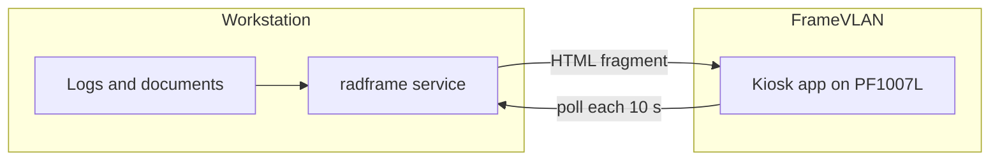

# RAD_PhotoFrame_AI

## What it is

RAD_PhotoFrame_AI makes a low-cost Android photo frame (PF1007L, from Amazon)
into a wall display of work status. The frame gets root through USB, and the
project disables the vendor software. A kiosk app shows the dashboards that a
Python service on a Windows 11 workstation makes.

The frame shows six dashboards in rotation:

| Dashboard | Contents |
| --- | --- |
| `now` | Clock, the next event, Claude Code today, CPU, GPU and memory of the workstation |
| `today` | Calendar for today and tomorrow, and the weather |
| `reflex` | Reflex digest: the week, the items that wait on Ron, the recent meetings |
| `health` | Garmin Connect and Strava values: sleep, Body Battery, HRV, heart rate at rest |
| `ai` | The local LLM cluster, the local GPU, and the Claude Code use today |
| `vibe` | Tokens today, the last 7 days, the projects today, the live sessions |

## How it works



Each 10 s, the frame gets from the host the dashboard to show. The host gives a
content version. When the version changes, the frame gets the new HTML. The
frame holds no credentials and no source documents. The frame network can
connect only to the host on TCP 8765.

## Hardware and runtime

| Part | Detail |
| --- | --- |
| Frame | PF1007L / AiMOR, Allwinner A33, 1 GiB RAM, 1280 x 800, Android 6.0.1, firmware `20260113` |
| Frame browser | Stock WebView 44, upgraded to WebView 106.0.5249.126 |
| Cable | USB-A to USB-C data cable (USB-C to USB-C gives no power or data) |
| Host | Windows 11 workstation, Python 3.12 or newer |
| Network | Frame-only VLAN or SSID, with egress rules on the router |

## Frame setup

The full procedure is in [`docs/FRAME_RUNBOOK.md`](docs/FRAME_RUNBOOK.md):
root ADB, backup, WebView, kiosk, lockdown and network. Do not connect the
frame to a network before you read it.

## Host start

The project has no `pyproject.toml` at this time. Install the packages by
name:

```powershell
cd G:\git\RAD_PhotoFrame_AI
python -m pip install fastapi uvicorn jinja2 markupsafe httpx psutil nvidia-ml-py `
  icalendar recurring-ical-events python-docx garminconnect
```

Make `config\radframe.toml` (git ignores it):

```toml
[frame]
adb_serial = "<frame USB serial>"

[host]
bind = "127.0.0.1"   # "0.0.0.0" after the frame network and the Windows rule are ready

[weather]
place = "<town>"
latitude = <latitude>
longitude = <longitude>

[[cluster]]          # optional: one entry for each llama.cpp node
name = "<name>"
url = "http://<address>:5150"
```

Start the host:

| Command | Function |
| --- | --- |
| `python -m radframe serve` | Run the host service in this console |
| `python -m radframe run` | Run the supervisor: one copy only, a log file, a restart when the service stops |
| `python -m radframe token` | Show the path of the frame token file |
| `pwsh -File tools\host\install_startup.ps1` | Start the supervisor at Windows logon, with no console window |
| `curl.exe http://127.0.0.1:8765/healthz` | Show the host state |

The host writes only to `%LOCALAPPDATA%\RAD_PhotoFrame\` (token, logs,
caches). The calendar addresses are in `calendars.key.txt` in the project
root, one `<label> <ics-address>` on each line.

## Status

| Item | State |
| --- | --- |
| Version | v0.1. The gates of S1.1 to S1.3 are satisfactory. The frame has the S1.5 changes, but `tasks/todo.md` has no gate record for S1.4 or S1.5. The host has six dashboards. |
| Last change | 2026-11-19: frame runbook, README update |
| Works | Root ADB through USB, WebView 106, kiosk as Home, vendor apps off, frame firewall, frame on the IoT Wi-Fi, host start at logon |
| Open | No automatic tests. No `pyproject.toml`. No DHCP reservation for the workstation. |

## Companion documents

- [Frame runbook](docs/FRAME_RUNBOOK.md)
- [Vision](docs/VISION.md)
- [Requirements](docs/REQUIREMENTS.md)
- [Success criteria](docs/SUCCESS_CRITERIA.md)
- [Architecture](docs/ARCHITECTURE.md)
- [Research survey](docs/2026-10-13_PhotoFrame_Dashboard_Research.md)
- [Project history](VIBE_HISTORY.md)
- [Implementation slices](tasks/todo.md)

## License

GNU General Public License, version 3 (GPL-3.0). See [LICENSE](LICENSE).
