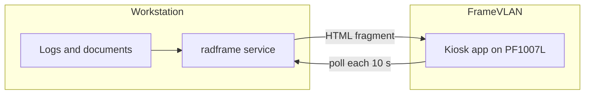

# RAD_PhotoFrame_AI

## What it is

RAD_PhotoFrame_AI makes a low-cost Android photo frame (PF1007L, from Amazon)
into a wall display of work status. The frame gets root through USB, and the
project disables the vendor software. A kiosk app shows the dashboards that a
Python service on a Windows 11 workstation makes.

The dashboards show:

- The AI work in progress (Claude Code and Codex).
- The status of the VIBE projects.
- The health of the hosts.
- The Reflex Security day and week.
- A family clock, calendar and weather.

## How it works



Each 10 s, the frame gets from the host the dashboard to show. The host gives a
content version. When the version changes, the frame gets the new HTML. The
frame holds no credentials and no source documents.

## Hardware and runtime

| Part | Detail |
| --- | --- |
| Frame | PF1007L / AiMOR, Allwinner A33, 1 GiB RAM, 1280 x 800, Android 6.0.1 |
| Frame browser | Stock WebView 44, upgraded to WebView 106.0.5249.126 |
| Cable | USB-A to USB-C data cable (USB-C to USB-C gives no power or data) |
| Host | Windows 11 workstation, Python 3.12 or newer |
| Network | Frame-only VLAN or SSID, with egress rules on the router |

## Quick start (development)

The host service has no code at this time. These steps are the plan for v0.1.

```powershell
git clone <repository> G:\git\RAD_PhotoFrame_AI
cd G:\git\RAD_PhotoFrame_AI
python -m venv .venv
.venv\Scripts\python -m pip install -e .[dev]
copy config\radframe.sample.toml config\radframe.toml
.venv\Scripts\python -m pytest
.venv\Scripts\python -m radframe serve
```

The frame procedure is in `docs/FRAME_RUNBOOK.md` (v0.0). Do not connect the
frame to a network before you read it.

## Status

| Item | State |
| --- | --- |
| Version | v0.0 not started. Design documents only. |
| Last change | 2026-10-13: vibe-init (vision, requirements, success criteria, architecture, two multi-AI reviews) |
| Works | No code and no frame changes at this time. |
| Next | v0.0 preflight: frame identity, host tools, router egress rules. |

## Companion documents

- [Vision](docs/VISION.md)
- [Requirements](docs/REQUIREMENTS.md)
- [Success criteria](docs/SUCCESS_CRITERIA.md)
- [Architecture](docs/ARCHITECTURE.md)
- [Research survey](docs/2026-10-13_PhotoFrame_Dashboard_Research.md)
- [Project history](VIBE_HISTORY.md)
- [Implementation slices](tasks/todo.md)

## License

MIT. See [LICENSE](LICENSE).
