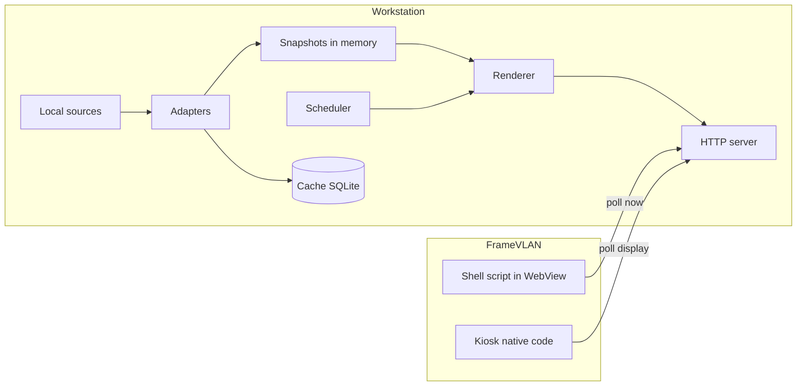
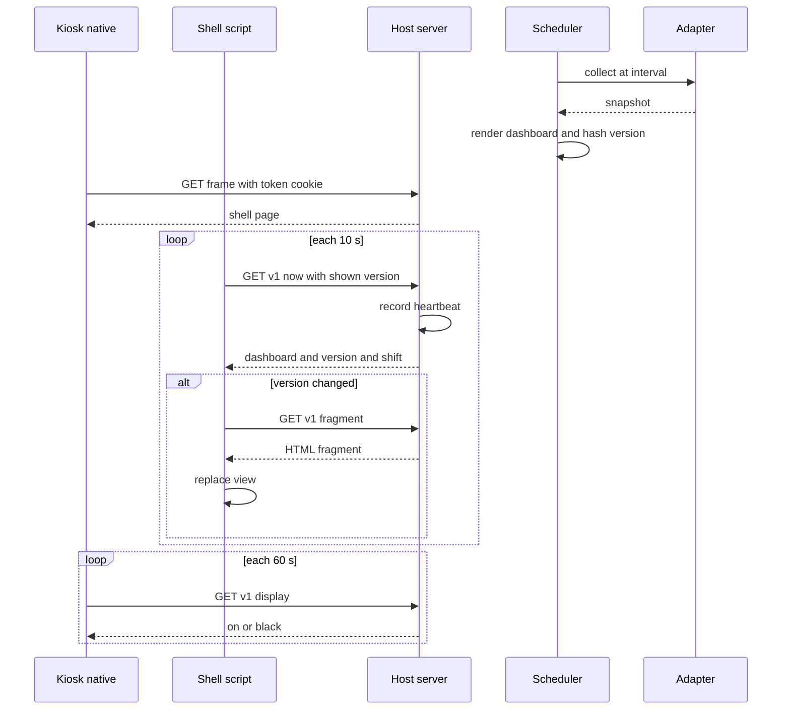

# Architecture: RAD_PhotoFrame_AI

Author: Claude for Ron Dilley.

Date: 2026-10-13. Status: draft, revised after the Phase 8 review
(`.ai-reviews/20261013-145421/synthesis.md`).

Companion documents: [VISION](VISION.md), [REQUIREMENTS](REQUIREMENTS.md),
[SUCCESS_CRITERIA](SUCCESS_CRITERIA.md),
[research survey](2026-10-13_PhotoFrame_Dashboard_Research.md).

This document tells why we made each design decision. The code gives the
procedures. Each decision section states the decision, the alternative, why
we selected it, and the risk. Section 19 connects each MUST requirement to the
section or document that satisfies it.

## 1. The shape of the system

The system has a weak, untrusted display and a strong, trusted host. The frame
is a PF1007L with 1 GiB RAM, Android 6 and a WebView that cannot go higher
than Chromium 106. It shows one page and gets from the host the dashboard to
show next. The host is Ron's Windows 11 workstation. It reads the data
sources, makes the content, selects the dashboard for the screen, and records
the time of each frame request.

Three properties make this system different from a usual dashboard:

1. **The display is hostile hardware.** The frame has root ADB with no
   authentication, a vendor remote root channel, and no browser updates
   (research survey §10, items 1 and 2). The design gives the frame nothing
   that has value apart from the rendered text on the screen.
2. **The data sources are files that other tools write.** Claude Code, Codex,
   VIBE projects and the weekly Reflex workflow write files for their own
   purposes. The host reads them and does not change them (SR-09).
3. **One reader looks at the screen for two or three seconds.** Each
   dashboard answers one question (NFR-10). The design puts work into
   correct, current data, not into many charts.



## 2. Decision: the frame is a display, and the host makes all content

- **Decision.** The frame runs a kiosk app that shows pages from one host
  origin. It has no dashboard logic, no credentials, no source documents and
  no stored data (AR-01, SR-07, REQUIREMENTS §0.4).
- **Alternative.** Put the dashboard logic on the frame, as the example
  dashboard does with its JavaScript views. Or, run Python on the frame.
- **Why.**
  1. The frame is not trusted. If tokens or logic are on the frame, a device
     on the network can get them when the containment stops.
  2. The frame has 1 GiB RAM and a 2014-class CPU. Work on the host is fast
     and does not change the memory of the kiosk.
  3. A change to a dashboard is a change on the host only. Ron does not
     install a new APK for a new dashboard.
- **Risk.** If the host is off, the frame shows nothing useful.
- **Mitigation.** The kiosk shows a clear "host offline" screen (FR-16). The
  host starts at logon and starts again after a crash (OPR-02).

## 3. Decision: server-made HTML with no build step and no framework

- **Decision.** The host makes each dashboard with Jinja2 templates and plain
  CSS. The frame runs one small script (`shell.js`) that polls the host and
  puts the new HTML fragment on the screen. There is no bundler and no
  JavaScript framework (NFR-01).
- **Alternative.** Keep the Vite build of the example dashboard, or use a
  Python UI framework (Reflex, NiceGUI, Streamlit).
- **Why.**
  1. The Python UI frameworks use a newer browser or more memory than the
     frame has (research survey §10, item 3).
  2. The Vite default target is Chrome 111 in 2026. A build step can add
     syntax that Chromium 106 cannot run, with no error at build time
     (research survey V2.3). With no build step, the code that we write is
     the code that the frame runs.
  3. The data is text and small tables. Server templates make this type of
     page with the smallest quantity of code.
- **Risk.** Hand-written JavaScript and CSS can use a feature that Chromium
  106 does not have.
- **Mitigation.** Three checks. The asset test (AR-03) reads the static files
  and the templates and stops on a list of features that Chromium 106 does
  not have (`color-mix`, `oklch`, CSS nesting, `dvh`, `:has()` until the frame
  test, `structuredClone`, `Array.prototype.toSorted`, `Object.groupBy`, and
  others). A Chromium load test finds console errors (TR-06). The last
  check is a screen capture from the frame (TR-02), because a static scan
  cannot find layout or memory problems.
- **Visual design.** The tokens come from the example dashboard
  (`EX/dashboard/css/tokens.css`): paper and ink colors, signal colors and a
  large clock. Fonts are files on the host, not Google Fonts, because the
  frame must not get to external hosts.

## 4. Decision: the frame polls the host, and the host selects the dashboard

- **Decision.** The shell sends `GET /v1/now?shown=<version>` each 10 s. The
  host gives the dashboard that must be on the screen at that time, its
  content version, and the pixel shift. If the version is different from the
  version on the screen, the shell gets the fragment and replaces the view.
  Section 5 gives the contract.
- **Alternatives.** Server-Sent Events (one open connection that the host
  pushes on), or a rotation timer in the frame script.
- **Why a poll.**
  1. The frame Wi-Fi is not reliable (discovery notes §3.2). A poll has no
     connection state. After a Wi-Fi drop, the next poll works with no
     reconnect logic.
  2. One request does three tasks: the change token (FR-14), the rotation
     (FR-12) and the heartbeat (OR-03). The host records the time and the
     `shown` version of each poll as the heartbeat.
  3. The rotation stays on the host (AR-01). The configuration changes on the
     host only, and the frame has no timer to drift.
- **Why a content version from a hash.** The version is the first 16 hex
  digits of the SHA-256 of the rendered content. It changes only when the
  content changes. No code must remember to change a version number.
- **Risk.** A new value can wait up to 10 s before it shows. This is less
  than each data age limit (NFR-04).
- **Memory.** The shell keeps one view in the DOM, not all views. The example
  dashboard keeps all views built and hidden. That is more memory than this
  frame must use for 72 hours (NFR-03).

## 5. Decision: one display contract with two renderers

<!-- AI review 20261013-145421: openai, gemini. Decision by Ron. -->

- **Decision.** The frame transport knows only one object, the rendered
  dashboard. A renderer makes it from snapshots. The HTML renderer is the
  primary renderer. The PNG renderer (section 15) uses the same
  contract, and the project builds it only if the WebView gate is not
  satisfactory.
- **Alternatives.** PNG as the only path (gemini), or HTML with no PNG path
  (xai).
- **Why.** Ron selected this contract (Phase 8 review). The transport, the
  heartbeat and the tests stay the same if the renderer changes. Touch detail
  views stay possible in vNext with HTML.

### 5.1 The rendered dashboard

| Field | Content |
| --- | --- |
| `dashboard` | Dashboard ID from the configuration |
| `version` | First 16 hex digits of the SHA-256 of the content |
| `kind` | `html` or `png` |
| `status` | Worst status of its snapshots: `ok`, `out_of_date` or `fault` |
| `data_age_s` | Age of the oldest snapshot in the dashboard |
| `sources` | Source names and references, for FR-13 |
| `shift` | Pixel shift `x` and `y`, from -6 to 6 px |
| `poll_s` | Seconds until the next poll (10) |

The host keeps the last 20 rendered versions in memory.

### 5.2 Routes

| Route | Caller | Response | Cache-Control |
| --- | --- | --- | --- |
| `GET /frame` | Kiosk WebView | Shell HTML page | `no-cache` |
| `GET /v1/now?shown=<version>` | Shell script | JSON of section 5.1. The host records the heartbeat. | `no-store` |
| `GET /v1/fragment/<version>` | Shell script | HTML fragment. HTTP 404 if the host no longer has that version. | `max-age=86400, immutable` |
| `GET /v1/png/<version>` | Shell for WebView 44 | PNG image (contingency only) | `max-age=86400, immutable` |
| `GET /v1/display` | Kiosk native code | JSON `{"display": "on"}` or `{"display": "black"}` | `no-store` |
| `GET /static/<file>` | Kiosk WebView | Script, CSS, font files | `no-cache` with an ETag |
| `GET /healthz` | Workstation loopback only | Last good run of each source, heartbeat age | `no-store` |
| `POST /admin/privacy` | Workstation loopback only | Privacy switch on or off | `no-store` |

### 5.3 Status codes and shell behavior

| Case | Host response | Shell behavior |
| --- | --- | --- |
| No token or an incorrect token | HTTP 403, plain text | Shows a "not authorized" panel and polls again each 60 s. |
| Unknown fragment version | HTTP 404 | Sends `/v1/now` again immediately. |
| Host error | HTTP 500 | Keeps the current view. After 3 errors in sequence, shows a small "host error" mark. |
| No connection | None | Keeps the current view and shows the data age. The kiosk native code shows the "host offline" screen when `/frame` cannot load (FR-16). |
| Admin route from a non-loopback address | HTTP 403 | Not applicable. |

The heartbeat in OR-03 is the `/v1/now` poll. It comes each 10 s, which is
more frequent than the 60 s limit of OR-03.

## 6. Decision: adapters make typed snapshots, and templates read only snapshots

- **Decision.** Each data source has one adapter. An adapter has a name, a
  refresh interval, a time limit and one method, `collect()`, that gives a
  `Snapshot`. Templates read snapshots only (AR-02).
- **The snapshot.**

| Field | Purpose |
| --- | --- |
| `source` | Adapter name |
| `source_ref` | File name and date, or endpoint, for FR-13 |
| `data_time` | Time of the newest data in the source |
| `collected_at` | Time of the collection |
| `status` | `ok`, `out_of_date` or `fault` |
| `fault` | The cause, when the status is `fault` |
| `degraded` | True when a fallback source made the data (for example the Reflex documents) |
| `payload` | A typed dataclass for that adapter |

- **Alternative.** Templates that read the sources directly, or one large
  data object for all dashboards.
- **Why.**
  1. The fault state (FR-15) has one shape for all sources. The template
     shows the fault panel from `status` and `fault`, and it does not have
     code for each source.
  2. A new dashboard that uses the available adapter capabilities is one
     adapter, one template and one configuration entry (FR-18).
  3. Tests can check an adapter and its snapshot without a browser.
- **The plugin boundary.** <!-- AI review 20261013-145421: openai --> The
  core supplies these capabilities: file reads, HTTP GET with a time limit,
  key-value state in SQLite, and keys from the host key files. A dashboard
  that uses only these is a plugin. A dashboard that adds a new capability
  (OAuth, a new process, a write) changes the core, and FR-18 does not apply
  to it.
- **Configuration.** One TOML file (`config/radframe.toml`) contains the
  dashboards (ID, template, adapters, display time, active hours) and the
  adapter settings (paths, intervals, hosts) (AR-04).

## 7. Decision: one host process, and the scheduler uses threads for file work

- **Decision.** The host is one Python 3.12 process: a FastAPI app on uvicorn
  with one worker. An asyncio scheduler starts each adapter at its interval
  and runs `collect()` in a thread pool, because most adapters read files.
  Snapshots stay in memory. A SQLite file in
  `%LOCALAPPDATA%\RAD_PhotoFrame\cache.sqlite` holds the usage totals and the
  read offsets of the transcript files (DR-03).
- **Alternatives.** A Windows service, a container, or a second collector
  process with a database server.
- **Why.**
  1. The adapters read files in Ron's user profile (`~/.claude`, `~/.codex`,
     the Desktop). A process in Ron's logon session reads them with Ron's
     permissions and with no other account.
  2. One process has one log, one health endpoint and one start command
     (AR-06).
- **Start.** A Task Scheduler task starts `pythonw -m radframe serve` at
  Ron's logon, and starts it again after a crash (OPR-02).
- **Time limits.** <!-- AI review 20261013-145421: openai --> Python cannot
  stop a thread that does not move. When the time limit of a `collect()`
  ends, the scheduler stops the wait and records a fault snapshot with the
  cause "time limit". It starts no new run of that adapter until the first
  run ends (single flight).
- **Bounded operations.** Each adapter uses subprocesses with a timeout and
  HTTP requests with a timeout.
- **Intervals.** The intervals satisfy the data age limits of NFR-04.

| Adapter | Interval | Time limit | NFR-04 limit |
| --- | --- | --- | --- |
| System and GPU | 10 s | 5 s | 30 s |
| Active sessions | 15 s | 5 s | 60 s |
| Claude Code and Codex tokens | 60 s | 30 s | 5 minutes |
| Projects | 120 s | 30 s | Not set |
| Reflex | 300 s | 60 s | 15 minutes after a new file |

## 8. Decision: transcript readers read only new bytes

- **Decision.** The Claude Code reader keeps, for each transcript file, its
  path, its size and the byte offset of the last complete line, in SQLite.
  Each read cycle reads from the offset to the end of the file. It parses
  only lines that end with a line feed. It adds token counts to daily totals
  by model and by project.
- **Duplicates.** The reader counts an assistant message only one time, by
  its message ID and request ID. A streamed message can write more than one
  line (IR-01). When a file becomes smaller, the reader starts that file
  again from byte 0.
- **Codex tokens.** The Codex reader reads the `token_count` events in the
  rollout files in `~/.codex/sessions`. These events have cumulative
  totals, so the reader keeps the last total for each session and adds the
  difference (IR-02).
- **Codex rate limits.** <!-- AI review 20261013-145421: openai --> The
  newest `token_count` event also has the rate limits: `used_percent`,
  `window_minutes` and `resets_at` for each window (research survey V4.4).
  The dashboard shows the newest values (FR-21).
- **Active sessions.** A session is active when two conditions are
  correct. Its transcript or rollout file changed in the last 15 minutes, and
  its last event time is in the last 15 minutes (FR-22). The project is the last part of the decoded folder name
  (Claude Code, for example `G--git-RAD-PhotoFrame-AI`) or the `cwd` of the
  session (Codex).
- **Claude Code rate limits (FR-23, SHOULD).** Claude Code gives the
  five-hour and seven-day percentages only to a status line command, and only
  for Pro and Max plans (research survey V4.3). The project supplies a small
  status line script that writes the newest values to
  `%LOCALAPPDATA%\RAD_PhotoFrame\claude_rate_limits.json`. Ron installs it in
  the Claude Code settings by hand. The host service does not change
  `~/.claude` (SR-09).
- **Alternative.** Run `ccusage` and read its output.
- **Why.**
  1. A full read of 136 MB at each refresh uses CPU for no new data. With the
     offset read, each read cycle takes less than 5 s (NFR-06).
  2. `ccusage` is a second tool to install and keep current. TC-20 uses it
     as a second, different count. That is a better use.
- **Risk.** The transcript format changes.
- **Mitigation.** The reader ignores unknown fields, and a line that it
  cannot parse goes to the log with its file and offset. A day with active
  sessions and zero tokens shows as a fault.

## 9. Decision: project and system readers use read-only commands

- **Projects (FR-24, FR-25).** The reader finds each folder in `G:\git` that
  has a `VIBE_HISTORY.md`.
  1. The newest entry is the first level-2 heading in `VIBE_HISTORY.md`,
     because these files put the newest entry first. The date is the first
     `YYYY-MM-DD` in the heading, and the title is the remaining text.
  2. The slice count is the count of `- [x]` lines (done) and of all
     checkbox lines (total) in `tasks/todo.md`.
  3. The git data comes from `git -C <path> log -1 --format=%cI` and
     `git -C <path> --no-optional-locks status --porcelain`, each with a 5 s
     time limit. The `--no-optional-locks` flag stops `git status` from a
     write to the index, so the reader does not write to the projects (SR-09).
  4. The sort key is the newest of the history file time, the todo file time
     and the last commit time. The dashboard shows the first 6.
- **System (FR-30).** `psutil` gives the CPU, memory and disk values.
  `nvidia-ml-py` gives the GPU load, memory, temperature and power. When NVML
  is not available, the GPU tile shows "no GPU data" (IR-10).
- **v0.4 readers.** Each one closes on its own gate (section 21).
  - llama-server: `/health`, `/metrics` (needs `--metrics`) and `/slots`.
    HTTP 503 from `/health` shows as "loading". The reader sends no
    completion request, so it does not wake a model that sleeps (IR-04).
  - Ollama `/api/ps`, vLLM `/metrics`, Glances REST API version 4 with a 5 s
    time limit (IR-09).
  - Node vitals (FR-31, `adapters/node_vitals.py`, added 2026-11-22). The
    inference nodes do not run Glances. The host keeps one SSH session open
    to each node as the `inference` user. The session sends a short `sh`
    loop on stdin.

    The loop reads `/proc/stat`, `/proc/meminfo` and the amdgpu, amdxdna and
    KFD files in `/sys`. It writes one line each 5 s. It installs nothing and
    writes nothing on the nodes. The values are:
    - CPU percent from the difference of two `/proc/stat` lines.
    - GPU busy percent: the average of five reads of `gpu_busy_percent`, one
      each second, because one read is not stable.
    - VRAM and GTT use, GPU temperature and GPU power from the amdgpu files.
    - RAM use from `MemTotal` minus `MemAvailable`.
    - NPU: the amdxdna driver gives no busy counter. The value is the part of
      the last minute in which `runtime_status` was `active`.
    - Top GPU process. Without root, the kernel gives no GPU time for each
      process. Thus the reader sorts the processes by VRAM.
      `/sys/class/kfd/kfd/proc/<pid>/vram_*` gives the ROCm processes of all
      users, and all users can read it. DRM fdinfo gives the Vulkan processes
      of the SSH user only. The name is the script for an interpreter, and
      the model alias for llama.cpp.

    If a session stops, the reader starts it again after 30 s, and the card
    shows the SSH error. A value older than 15 s shows as "no data". When the
    host process stops, `ssh` cannot write its output and stops too. The SSH
    key stays on the workstation. The frame gets only the values.
  - Provider admin APIs: with no admin key file, the panel shows "not
    configured". Each request has a 10 s time limit (IR-05).
  - Open-Meteo: no key. The reader keeps the last good forecast for a
    maximum of 6 hours (IR-06).
  - Google Calendar: OAuth desktop flow with the `calendar.readonly` scope.
    The token file stays in `%LOCALAPPDATA%\RAD_PhotoFrame\` (IR-07). This is
    a new core capability (section 6), so it is a core change.

## 10. Decision: Reflex data comes from a JSON file first, with the documents as a degraded fallback

- **Decision.** Ron chose this contract (Phase 6 review). The weekly
  workflow writes `dashboard/YYYY-MM-DD_reflex_dashboard.json` next to the
  Word files. The adapter reads that JSON when its date is the same as or
  newer than the newest document. Else it parses the documents (FR-42), and
  it sets `degraded` on the snapshot. The panel then shows "from documents
  (fallback)" in its source line.
- **The JSON schema (version 1).** The project supplies the schema in
  `tools/reflex/reflex_dashboard.schema.json` and a PowerShell step for the
  weekly workflow (FR-49). All fields must be in the file unless the table
  says optional. A file with a `schema_version` that the adapter does not know is
  a fault.

| Field | Content |
| --- | --- |
| `schema_version` | `1` |
| `week_of` | Monday date of the week |
| `generated_at` | Time the workflow wrote the file |
| `week_line` | The week in one line |
| `priorities` | Up to 5 items: title, why, when |
| `today` | Date, the day in one line, and the time table rows |
| `actions_today` | Items: ID, action, due |
| `actions_week` | Items: ID, action, due |
| `wins`, `risks` | Short text items (optional) |
| `exercises_week` | Items: client, date and time (optional) |
| `blocker` | Text (optional) |

- **Alternatives.** Parse the documents only, or read JSON only.
- **Why.**
  1. A JSON file with a schema is a contract. A table layout in a Word file
     that a model makes is not a contract, and it changed in August 2026.
  2. The document fallback keeps the panel useful until the weekly workflow
     writes the JSON. Each document parser is one file (MR-02).
- **Other formats.** A legacy `.doc` file gets the fault "format not
  available", and the adapter uses the newest `.docx` or `.md` file. The
  platform usage HTML goes through the Python standard `html.parser` as text.
  No script in it runs (IR-03).
- **Path guard.** <!-- AI review 20261013-145421: openai --> One module,
  `adapters/reflex/guard.py`, does all path work for SR-08:
  1. It resolves the root with `os.path.realpath(strict=True)`.
  2. It reads only the FR-40 folders with `os.scandir`. For each entry, it
     gets `entry.stat(follow_symlinks=False)` and refuses the entry if
     `st_file_attributes` has `FILE_ATTRIBUTE_REPARSE_POINT`, or if the entry
     is a symlink. This refuses symlinks and junctions.
  3. It compares the file name with the FR-40 patterns, and it applies the
     SR-08 deny rules before it opens a file.
  4. It opens the file read-only and compares `os.fstat` of the open file
     with the earlier `stat` result (`st_ino`, `st_dev`). If they are
     different, a change occurred between the check and the open, and the
     guard refuses the file.
- **Guard boundary.** The other Reflex modules get only open files from the
  guard. TR-04 tests the guard with the files and paths that SR-08 names.
- **Memory only.** Reflex text stays in the snapshot in memory. It does not
  go into SQLite, into the log or into a file (DR-02, OR-01).
- **Risk.** The weekly workflow does not write the JSON, or writes it with
  errors.
- **Mitigation.** The adapter checks the JSON against the schema. A file that
  does not agree with the schema is a fault on the panel, and the adapter
  uses the documents.

## 11. Decision: network containment is the primary control, and the token is secondary

- **Decision.** The access control has four layers:
  1. The router puts the frame on its own VLAN or SSID, with no other device
     on it. It stops all frame traffic to the vendor ports and to other
     hosts. Only the dashboard port on the workstation is open to the frame
     (SR-01, SR-02).
  2. The host server listens on the workstation address only. A Windows
     firewall rule lets only the frame-only subnet get to that port. When the
     MAC pin (FR-09) works, a DHCP reservation narrows the rule to one
     address (SR-04). <!-- AI review 20261013-145421: gemini -->
  3. The kiosk sets a cookie `rf_token` for the host origin before it loads
     the first page. The server refuses requests without the correct token
     with HTTP 403 (SR-05).
  4. Each page has a Content-Security-Policy header that permits only the
     host origin (SR-06). The pages load no external asset. The header is:

     ```text
     Content-Security-Policy: default-src 'self'; frame-ancestors 'none'
     ```

- **Why the MAC address is important.** The PF1007L gets a new MAC address at each boot
  unless the boot fixes pin it (discovery notes §3.2). A rule for one IP
  address then stops the frame. A frame-only subnet keeps the rule correct,
  and no other device is on that subnet.
- **Alternative.** Mutual TLS, or a token as the primary control.
- **Why.**
  1. A person with root on the frame can read each token or client key on
     it. So the token cannot be the primary control. The network rules do not
     use a secret on the frame.
  2. The token stops requests that come by error, at low cost.
- **Transport.** Plain HTTP on the frame VLAN with WPA2 or WPA3 Wi-Fi
  (assumption A6, SR-14). HTTPS with a private CA and a certificate that the
  kiosk pins is vNext.
- **Risk.** The router does not support the egress rules or a frame-only
  VLAN.
- **Mitigation.** TC-07 tests the rules before the frame connects to Wi-Fi.
  If the router cannot do this, the project uses USB-only mode (SR-15).

## 12. Decision: each dashboard has a layout budget

<!-- AI review 20261013-145421: gemini, openai -->

- **Decision.** Each dashboard has a fixed layout on the 1280 x 800 screen
  and a maximum item count. Data that does not fit shows as "+N more" with the
  source reference. Nothing scrolls.
- **The layout.** From top to bottom, the screen has four areas:
  1. A header of 64 px with the dashboard name, the clock and the data age.
  2. A primary area for the answer to the primary question (NFR-10).
  3. A secondary area.
  4. A footer of 24 px with the source references (FR-13).
- **Text size.** Primary values are 48 px or more. No text is less than
  18 px (NFR-08).
- **Two Reflex dashboards.** The Reflex data is too much for one glance. It
  becomes "Reflex today" and "Reflex week" in the rotation. Each satisfies
  FR-43 to FR-46 with fewer items on the screen.

| Dashboard | Primary area | Secondary area | Item limits |
| --- | --- | --- | --- |
| Clock and system (v0.1) | Time and date | CPU, memory, disk, GPU tiles, heartbeat age | 6 tiles |
| Vibe | Active sessions | Tokens today and 7 days, rate-limit bars | 4 sessions, 2 bars |
| Projects | Projects that changed | Slice counts, last commit, files not committed | 6 projects |
| Reflex today | The day in one line | Time table, actions today | 6 rows, 5 actions |
| Reflex week | The week in one line | Top 5 priorities, wins, risks, blocker | 5 priorities, 3 wins, 3 risks |
| Family (v0.4) | Time, weather | Events today and tomorrow | 6 events |

- **Page budget (NFR-02).** `shell.js` less than 10 KB, CSS less than 30 KB,
  two font files less than 200 KB in total, and each fragment less than
  50 KB. The total is less than 300 KB. The asset test (AR-03) checks these
  sizes.
- **Pixel shift (NFR-09).** The host calculates the shift from the clock: a
  new `x` and `y` from -6 to 6 px each 60 s. The shell applies it as a CSS
  transform on the view.

## 13. Decision: a fork of the example kiosk app, with four changes

- **Decision.** The kiosk is a fork of `EX/dashboard/kiosk/` (no Gradle,
  builds on Windows with `build.ps1`). It keeps the screen-on flag, the
  immersive mode, the offline screen and the retry. It has no JavaScript
  bridge (SR-11). The four changes:
  1. **Origin pin.** `shouldOverrideUrlLoading` and the resource load filter
     refuse each URL that is not on the configured host origin.
  2. **Token cookie.** The kiosk reads the host URL and the token from its
     settings, and sets the cookie with `CookieManager` before the first
     load.
  3. **One-finger escape.** One finger that stays without movement for 3 s in
     a 120 x 120 px area at the top-left corner opens the kiosk menu (Android
     Settings, Wi-Fi settings, launcher, reload). The example two-finger hold
     does not work on the `gslX680` panel (FR-07). A corner area prevents an
     accidental open.
  4. **Night black mode.** <!-- AI review 20261013-145421: gemini, openai -->
     The kiosk native code sends its own `GET /v1/display` each 60 s with the
     token cookie, through `HttpURLConnection`. It does not read the WebView
     traffic, so there is no JavaScript bridge. For `black`, the kiosk sets
     the window brightness to 0 and puts a black view on top of the WebView.
     For `on`, it removes the view and sets the usual brightness again.

     Night black mode is not a screen sleep. The backlight stays on at its
     lowest level (FR-19).
- **Alternative.** Fully Kiosk Browser.
- **Why.**
  1. Fully Kiosk has a REST API with a root command on rooted devices. That
     is a second remote root channel (research survey V7.2).
  2. The example kiosk is small, has no bridge, and builds without Gradle on
     Windows.
- **Risk.** The `gslX680` panel reads the corner hold as a different gesture.
- **Mitigation.** Ron tests the escape by hand three times before AiMOR is
  disabled (TC-03, FR-06). Persistent USB root ADB is the second access path
  (FR-05).

## 14. Decision: the frame procedure is a runbook of guarded steps

<!-- AI review 20261013-145421: openai, gemini -->

- **Decision.** `docs/FRAME_RUNBOOK.md` is a sequence of steps. Each step has
  an ID, a class (read or write) and the identity checks that must agree
  before it starts. It also has the command, the expected output, the stop
  condition, and, for a write, the undo. The project scripts in `tools/frame/` do the checks and
  the records. The hardware scripts of the example repository stay at commit
  `0c0defb`, and the runbook refers to them.
- **Alternative.** Copy the example scripts into this repository, or run the
  procedure from notes.
- **Why.**
  1. The PF1007L can lock out or stop after one incorrect write
     (discovery notes §6). A step format with a stop condition makes rule R4
     (stop at the first mismatch) a property of each step.
  2. The upstream repository changes each week. A pinned reference gets
     upstream fixes when Ron moves the pin, and Ron reads the upstream diff
     first.

### 14.1 The step protocol

| Part | Mechanism | Requirement |
| --- | --- | --- |
| Identity check | `tools/frame/identity.py` reads the USB ID, serial, `ro.product.model`, fingerprint and firmware string, and compares them with `frames/<unit>/identity.json`. A different value stops the step. | FR-01, IR-08 |
| Approval | For a write, `tools/frame/step.py` shows the command and the undo, and Ron types the step ID as the approval. | FR-03 |
| Record | `step.py` writes one line to `frames/<unit>/changes.jsonl` before the write and one line after it. | OR-04, FR-10 |
| Readback | Each write has a readback command. The step stops when the readback is different. | R3 |
| Downloads | `tools/frame/bom.toml` contains each download with its full SHA-256. `tools/frame/fetch.py` refuses a file with a different hash. In v0.0, Ron records the full hash values from the upstream documents. | SR-12 |

### 14.2 Backup checks

`tools/frame/verify_backup.py` checks each backup image and writes the
result to `frames/<unit>/backups.json` (FR-02):

1. The byte count is the same as the disk size from the device.
2. Two different full reads give the same SHA-256.
3. A gzip readback of the compressed file gives the same SHA-256.
4. No 1 MiB area of the image is only `0xCC` filler.

### 14.3 Route selection

The runbook selects the route from the v0.0 identity data:

1. If `adb -d shell id` gives root on the stock firmware (some 20260529
   units), no boot patch is necessary.
2. Else, Route U from Windows with WSL and usbipd, with the 12 MHz or no-HS
   U-Boot build for the eMMC size of the unit.
3. The recovery-window write is the last selection. It erases the user data,
   and no report shows a test on Windows.

### 14.4 Port lockdown (SR-03)

After root ADB through USB works (FR-05), the lockdown step:

1. Clears each `adb.tcp.port` property (`service.adb.tcp.port` and
   `persist.adb.tcp.port`) and starts `adbd` again, so `adbd` listens on USB
   only.
2. Disables the vendor packages (FR-06). This stops the AiMOR file service on
   TCP 8086.
3. Installs an `iptables` input rule set through the boot-fix bundle
   (`EX/scripts/pf1007l-boot/`): accept loopback traffic and `ESTABLISHED` traffic,
   and drop new inbound connections.
4. Checks after a power cycle that `netstat -an` shows no socket in the
   `LISTEN` state, other than loopback.

### 14.5 Token rotation (SR-05)

`python -m radframe rotate-token` makes a new token and writes it to the
host token file in `%LOCALAPPDATA%\RAD_PhotoFrame\`. `tools/frame/set_token.ps1`
sends it to the kiosk settings through USB ADB. The step then checks that a
request with the previous token gets HTTP 403. The runbook does this at the
end of each physical maintenance session.

### 14.6 Recovery

- **To Android Settings.** The one-finger escape (section 13), or USB root ADB
  with `am start` of the Settings app (OPR-04).
- **To stock firmware.** For each changed partition, the runbook writes the
  partition image from the verified backup through USB root ADB, and reads it
  back. Before the first write to a partition, the runbook records the
  partition offsets from the backup. A full eMMC restore uses the upstream
  Route U procedure, with its own approval from Ron (OPR-04, BC-02).

### 14.7 Kiosk build and install (OPR-03)

`tools/frame/kiosk_install.ps1` builds the APK with `kiosk/build.ps1`,
installs it through USB ADB, sets the host URL and the token, and starts it.

## 15. Decision: the PNG renderer is a contingency behind the same contract

- **Decision.** If the WebView gate (FR-08, TC-06) is not satisfactory, the
  host makes a PNG of each rendered dashboard with Playwright Chromium at
  1280 x 800. It does this only when the content version changes. A small
  shell for the stock WebView 44 shows the PNG and polls `/v1/now` with ES5
  code. The renderer runs in its own worker process, because Playwright and
  the uvicorn event loop do not work together on Windows (research survey
  V3.3, AR-05).
- **Alternative.** Make the PNG path for each frame from v0.1.
- **Why.**
  1. The WebView 106 upgrade worked on other PF1007L units (research survey
     §2.2). The PNG path is work that is probably not necessary.
  2. The display contract (section 5) and the templates stay the same. Only
     the renderer and the shell change.
- **Risk.** A PNG has no touch targets.
- **Mitigation.** The v0.1 to v0.4 dashboards are display only.

## 16. Cross-cutting topics

- **Observability.** Each collector run writes one JSON log line (source,
  time, duration, item count, error) to
  `%LOCALAPPDATA%\RAD_PhotoFrame\logs\` with daily rotation (OR-01). The log
  has no Reflex text. `/healthz` gives the last good run of each source and
  the age of the last frame heartbeat (OR-02).
- **Errors.** Each adapter catches its own errors and gives a fault
  snapshot. The scheduler records an error that comes through the catch as a
  defect in the log. The HTTP server does not stop for an adapter error.
- **Privacy of artifacts.** <!-- AI review 20261013-145421: openai -->
  - The multi-AI review runs send only the documents in `docs/`, `tasks/` and
    `background/goal.md`. The review command does not send `diagnostics/`,
    `frames/`, `backups/` and the host cache (DR-04).
  - Screen captures go to `diagnostics/<slice>/`. A slice closes only after
    the project deletes its Reflex captures (DR-07).
  - `.gitignore` covers `*.key.txt`, `frames/`, `backups/`, `diagnostics/`,
    `runs/` and the local configuration with the token (SR-10). The host
    cache is not in the repository. No dump, serial, MAC address, Wi-Fi data
    or vendor APK goes into the repository (DR-06).
- **Read-only host.** The host writes only to
  `%LOCALAPPDATA%\RAD_PhotoFrame\` (SR-09).
- **Cost.** No paid service in v0.1 to v0.3. Open-Meteo has no key. The
  provider admin APIs (v0.4) are optional.
- **Time.** The host records UTC and shows America/Los_Angeles (DR-05). The
  frame has no battery clock, so the clock on the screen comes from the host
  fragment, not from the frame.

## 17. Module layout

```text
pyproject.toml            Package data, ruff settings, pytest settings (MR-01)
radframe/                 Python package for the host service, with type hints
  __main__.py             Command line: serve, check-config, rotate-token
  config.py               TOML configuration and validation
  app.py                  Routes of section 5.2
  security.py             Token check, CSP header, loopback check for admin routes
  scheduler.py            Intervals, time limits, single flight, rotation choice
  snapshot.py             Snapshot dataclass and status values
  contract.py             Rendered dashboard of section 5.1
  registry.py             Dashboards and adapters from the configuration
  render_html.py          Jinja2 renderer and the content version
  render_png.py           Playwright worker client (only when FR-17 applies)
  store.py                SQLite: usage totals, transcript offsets
  adapters/
    system.py             psutil and nvidia-ml-py
    claude_code.py        Transcript reader, active sessions, rate-limit file
    codex.py              Rollout reader, token_count differences, rate limits
    projects.py           VIBE_HISTORY.md, tasks/todo.md, read-only git
    reflex/
      guard.py            Path guard for SR-08
      json_source.py      JSON contract reader with schema check
      docx_source.py      Word document fallback
      md_source.py        Marlow section fallback
      html_source.py      Platform usage HTML as text (v0.4)
    weather.py  gcal.py  llm_cluster.py  provider_usage.py   (v0.4)
    node_vitals.py        SSH reader: CPU, GPU, VRAM, RAM, NPU, GPU processes
  templates/              shell.html and one template for each dashboard
  static/                 shell.js, tokens.css, base.css, font files
kiosk/                    Fork of the example kiosk app (Java, no Gradle)
tools/frame/              identity, step, fetch, bom.toml, verify_backup, set_token, kiosk_install, soak, portscan
tools/reflex/             JSON schema and the PowerShell step for the workflow
tools/claude/             Status line script for the Claude Code rate limits
config/                   radframe.sample.toml (the local radframe.toml is ignored)
tests/                    pytest, with live-source tests on the workstation
docs/                     VISION, REQUIREMENTS, SUCCESS_CRITERIA, ARCHITECTURE, FRAME_RUNBOOK, OPERATIONS
frames/  backups/  diagnostics/   Ignored private folders (SR-10)
```

`docs/OPERATIONS.md` (OPR-01) gives the host start task, the configuration,
the token rotation, the privacy switch, the logs and the health endpoint.

## 18. Data flow



## 19. MUST coverage

<!-- AI review 20261013-145421: openai, xai -->

This table connects each MUST requirement to the section, document or test
that satisfies it. "Runbook" is `docs/FRAME_RUNBOOK.md`. "Ops" is
`docs/OPERATIONS.md`.

| Requirements | Where |
| --- | --- |
| FR-01, FR-03, FR-10 | §14.1, Runbook |
| FR-02 | §14.2 |
| FR-04, SR-01, SR-02 | §11, Runbook, TC-07 |
| FR-05, FR-06 | §14.3, §14.4, Runbook, TC-01, TC-02 |
| FR-07 | §13, TC-03 |
| FR-11, FR-14, FR-16 | §4, §5 |
| FR-12, FR-13, FR-15 | §5.1, §6, §7 |
| FR-17, AR-05 | §15 (contingency) |
| FR-18 | §6 plugin boundary |
| FR-20, FR-21, FR-22, IR-01, IR-02 | §8 |
| FR-24, FR-30, IR-10 | §9 |
| FR-32, OR-03 | §5.2, §5.3 |
| FR-40 to FR-45, FR-48, FR-49, IR-03, SR-08 | §10 |
| FR-50 | §12 |
| FR-51, FR-52, IR-04 to IR-07, IR-09 | §9 v0.4 readers |
| NFR-01 | §3, AR-03 test |
| NFR-02, NFR-08, NFR-09, NFR-10 | §12 |
| NFR-03, NFR-05 | §4, §20, TC-10, TC-11 |
| NFR-04, NFR-07 | §7 |
| NFR-06 | §8, TC-17 |
| SR-03 | §14.4, TC-05 |
| SR-04, SR-05, SR-06 | §11, §14.5 |
| SR-07, SR-09, SR-10 | §2, §16 |
| SR-11 | §13, TC-36 |
| SR-12 | §14.1 |
| SR-13 | §5.2, Ops |
| DR-01 to DR-07 | §10, §16 |
| OR-01, OR-02, OR-04 | §16, §14.1 |
| OPR-01 | §17, Runbook, Ops |
| OPR-02 | §7 |
| OPR-03 | §14.7 |
| OPR-04 | §14.6 |
| AR-01 to AR-04, AR-06 | §2, §3, §6, §7 |
| MR-01 | §17 |
| MR-02 | §10 |
| MR-03 | Slice 0 task in `tasks/todo.md` |
| TR-01 to TR-06 | SUCCESS_CRITERIA §3 |

## 20. Failure modes

| Failure | What shows it | Recovery |
| --- | --- | --- |
| Host off or service crash | Kiosk "host offline" screen. Heartbeat age on `/healthz` increases. | Task Scheduler starts the service again. The kiosk retries each 5 s. |
| Frame Wi-Fi drop | Heartbeat age increases on the system dashboard (FR-32). | The boot fixes and the Android Wi-Fi reconnect. If drops continue, USB-only mode (SR-15). |
| Frame gets a new MAC address | The frame-only subnet rule lets it connect. Heartbeat continues. | Repair the MAC pin. Narrow the rule again. |
| Frame power cycle | Heartbeat stops, then starts. | The kiosk is the Home app and starts at boot (NFR-05). |
| Source file not found or not readable | Fault panel with the cause (FR-15). | The adapter tries at its next interval. |
| Reflex document format change | Fault or degraded mark on the Reflex dashboards. | Repair one parser (MR-02). The JSON contract prevents most of these faults. |
| Reflex documents older than 8 days | "Out of date" mark (FR-48). | Ron runs the weekly workflow. |
| Transcript format change | Parse errors in the log. Fault on a day with sessions and zero tokens. | Repair the reader. |
| Adapter blocked | Fault "time limit". No new run until the blocked run ends. | Next interval after the blocked run ends. |
| Kiosk memory increases | Soak sampler (TR-05), with the daily reload off during the soak (TC-10). | In production, a daily reload at 03:00 from the shell. |
| Escape gesture does not work | TC-03 before lockdown. | USB root ADB (FR-05). |
| Vendor app comes back after a power cut | `netstat` check in the monthly scan (TC-05). Home chooser on the screen. | Runbook step to disable again. The router rules stop its traffic. |
| WebView 106 does not work | TC-06. | PNG contingency (section 15). |

## 21. Version boundary

| Version | Contents |
| --- | --- |
| v0.0 | Runbook steps T1 and T2, identity capture, host tools, BOM hash values, VLAN preflight (TC-07). No write to the frame. |
| v0.1 | Backup, root, port lockdown, kiosk fork, WebView gate. Host skeleton: routes of section 5.2, security, scheduler, HTML renderer, the clock and system dashboard. Asset test. 24-hour frame run. |
| v0.2 | Claude Code, Codex and project adapters. `store.py`. Rotation and the registry. |
| v0.3 | Reflex adapter, path guard, JSON schema and workflow step, the two Reflex dashboards, privacy switch. 72-hour soak. |
| v0.4 | Each integration closes on its own gate: weather, calendar, night black mode, local LLM cluster, provider usage. Then the 14-day run. |
| vNext | HTTPS with a private CA, touch detail views, more dashboards. |

## 22. Open questions

- **Frame identity.** The firmware suffix, the eMMC size and the ADB state of
  Ron's unit are not known (discovery notes OQ1, OQ2). v0.0 answers them.
- **Router capability.** Can Ron's router make a frame-only VLAN or SSID with
  egress rules? TC-07 in v0.0 answers this.
- **LLM cluster hosts.** Closed on 2026-11-22. The hosts are `tars`, `case`,
  `kipp` and `plex` (Strix Halo, gfx1151, llama.cpp on TCP 5150). They are in
  `config/radframe.toml`.
- **Rotation interval.** No research gives a number. The default is 30 s for
  each dashboard, and Ron changes it in the configuration.
- **`:has()` support.** The research survey and the example repository do not
  agree. The asset test forbids it until a test on the frame.
- **Wi-Fi reliability.** No report shows more than three or four days of
  PF1007L Wi-Fi with the boot fixes. The 24-hour v0.1 run is the first data.
- **True screen sleep.** Night black mode keeps the backlight on at its lowest
  level. A full sleep must have keyevent 223 and 224 from a root process on the
  frame or from USB ADB. A decision is necessary before v0.4.
- **Privacy switch control.** The switch is `POST /admin/privacy` from the
  workstation. A keyboard shortcut or a tray icon can come after v0.3.
